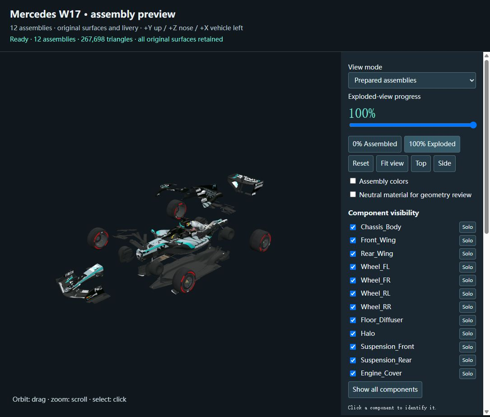

# F1 Car Dissection

**W17 — The Architecture of Speed** is an interactive 3D engineering study built around a Mercedes-liveried Formula 1 car. Follow a cinematic journey from the circuit to the studio, explore an exploded view of the car, and inspect its major assemblies and V6 engine mechanisms.

The project combines a React web experience with model inspection tools, preparation scripts, and the source assets used to build it.



## Features

- **Scroll-driven cinematic story:** move between racing, bullet time, component studies, reassembly, and departure.
- **Exploded-view exploration:** inspect wings, wheels, suspension, brakes, floor, halo, monocoque, engine cover, and power unit.
- **Interactive engine study:** identify engine parts and explore piston and crankshaft motion.
- **Playback controls:** play, pause, scrub the timeline, replay, or jump to a chapter.
- **Component selection:** click visible parts to highlight their assemblies.
- **Reduced-motion mode:** follows the operating-system preference and can be changed in the interface.
- **Development tools:** dedicated brake and running-gear study pages, an original model inspector, and a prepared-model preview.
- **Reversible animation:** scene transforms are derived from timeline progress so scrolling backward restores earlier states.

## Technology

React 19, Vite 7, Three.js, React Three Fiber, GSAP / ScrollTrigger, and Tailwind CSS 4. Model preparation uses Python, Blender, and Node.js scripts. Assets use the glTF / GLB format.

## Getting Started

### Requirements

- Node.js **22.12 or newer**.
- pnpm available on your command line.
- Git and **Git LFS** to download the model assets.
- A modern browser with WebGL and hardware acceleration enabled.

### Clone the repository

```sh
git lfs install
git clone https://github.com/GamERs-007/F1-car-dissection.git
cd F1-car-dissection
git lfs pull
```

Large model and Blender files are stored with Git LFS. Use the commands above to obtain their actual contents; a source archive may contain LFS pointer files depending on GitHub's archive settings.

### Install and start

From the repository root:

```sh
cd 2026-mercedes-w17/cinematic
pnpm install --frozen-lockfile
pnpm dev
```

Open **http://127.0.0.1:5173/**. On Windows, after installing dependencies, you can also double-click `start.bat` in the repository root.

Keep the directory structure intact: the app loads shared assets from `2026-mercedes-w17/public/`, the original car from `2026-mercedes-w17/source/`, and the supplied engine from `v6 engine/`.

### Build and preview

Run from `2026-mercedes-w17/cinematic/`:

```sh
pnpm build
pnpm preview
```

The production site is written to `dist/` within that directory. The build includes the shared public assets and copies the original reference car and supplied V6 model. The default preview URL is **http://127.0.0.1:5173/**; stop the development server first if it is using the same port.

## Controls

| Control | Action |
| --- | --- |
| Scroll or drag the progress slider | Move forward or backward through the story |
| Play / Pause | Start, pause, or resume automatic playback |
| Chapter navigation | Travel to a component study or story chapter |
| Click a visible component | Select and highlight its assembly |
| Click the selected component label | Clear the selection |
| Reduced Motion / Full Motion | Change the motion preference |
| W17 logo or Replay the Story | Return to the beginning |

The Power Unit chapter includes controls for the complete engine and piston study. The motion and engineering guides are illustrative rather than physical simulations.

## Project Structure

```text
.
├── 2026-mercedes-w17/
│   ├── cinematic/          # Main React / Vite application, tests, and study tools
│   ├── preview/            # Prepared-car and power-unit preview
│   ├── public/
│   │   ├── models/         # Prepared GLB models and component configuration
│   │   └── lighting/       # HDR environment and attribution
│   ├── source/             # Original supplied car model
│   └── textures/           # Supplied texture assets
├── inspection/             # Original-model inspector, reports, and vendored Three.js
├── preparation/            # Blender / export scripts, workfiles, and validation data
├── v6 engine/              # Supplied V6 engine model
└── start.bat               # Windows development launcher
```

Dependencies, build output, package caches, the portable Blender installation, automatic Blender backups, and local browser captures are excluded from version control.

## Tests and Model Validation

Run the application regression suite from `2026-mercedes-w17/cinematic/`:

```sh
pnpm test
```

The suite covers animation and chapter timing, playback transport, geometry alignment, engine motion, material behavior, and asset fidelity. Some tests read the actual GLB files, so complete the Git LFS download before running them.

To validate the prepared car from the repository root:

```sh
node preparation/validate.mjs
```

Additional technical notes:

- [Cinematic application](2026-mercedes-w17/cinematic/README.md)
- [Engine integration](2026-mercedes-w17/cinematic/ENGINE-INTEGRATION.md)
- [Preparation workflow](preparation/README.md)
- [Preparation report](preparation/REPORT.md)
- [Original model inspection](inspection/README.md)

The optional preparation workflow expects Blender at the local path described in its guide. Blender is not bundled in this repository and is not required to run the web app.

## Asset Notes and Limitations

This is an independent visualization and engineering study. The model name and livery do not establish that the geometry represents verified Mercedes engineering data. Component grouping, engine internals, brake assemblies, and explanatory motion include illustrative approximations; they are not intended as manufacturing CAD or a service procedure.

The large GLB assets are the main download cost. Initial loading can take time, especially on slower connections. Vite may also report a large JavaScript chunk advisory for the 3D renderer.

The lighting environment, **Studio Small 09** by Sergej Majboroda / Poly Haven, is CC0; see the included [lighting attribution](2026-mercedes-w17/public/lighting/LICENSE.md). Vendored Three.js retains its own license. The [AMG asset note](2026-mercedes-w17/cinematic/src/assets/AMG-SOURCE.md) records the logo source.

Third-party models, textures, logos, and trademarks remain subject to their respective owners' rights. This repository does not grant additional rights to those assets or imply affiliation with Mercedes-AMG or Formula 1.
